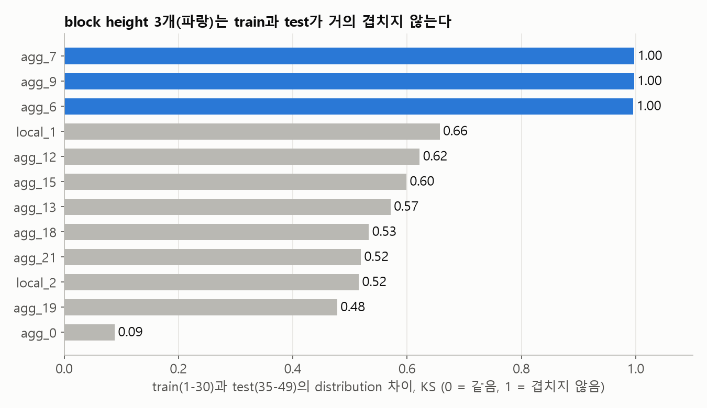
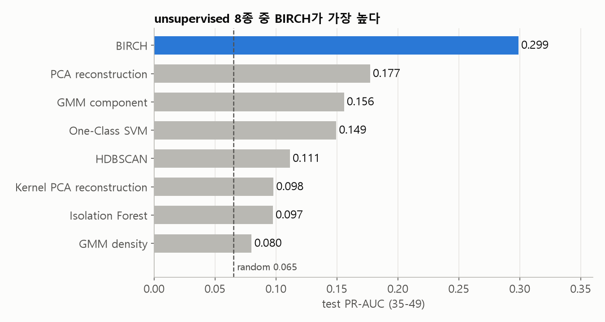
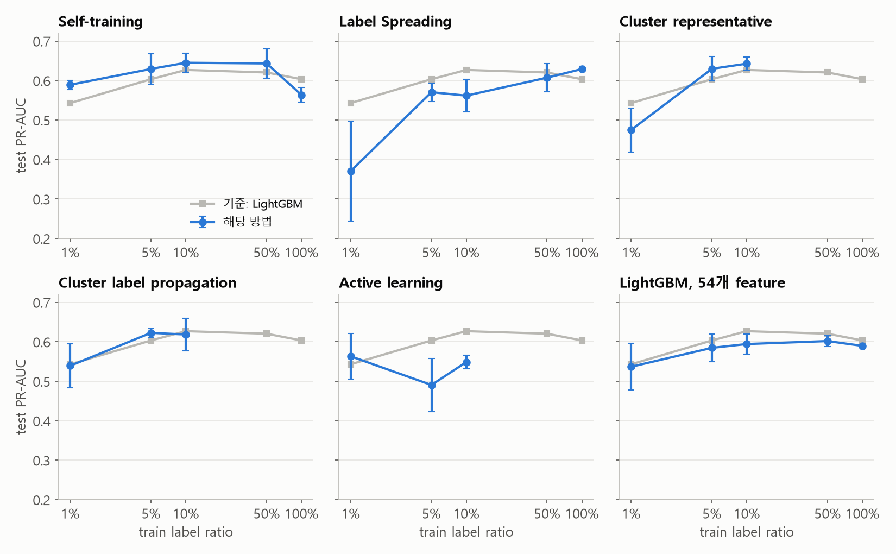
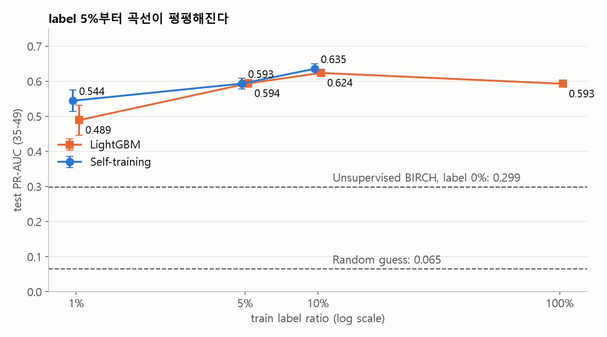
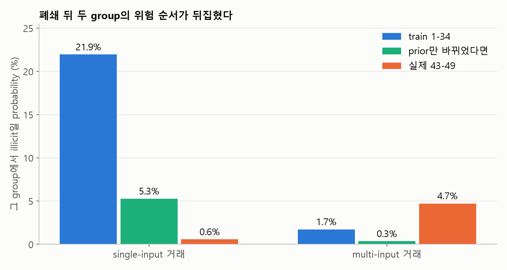
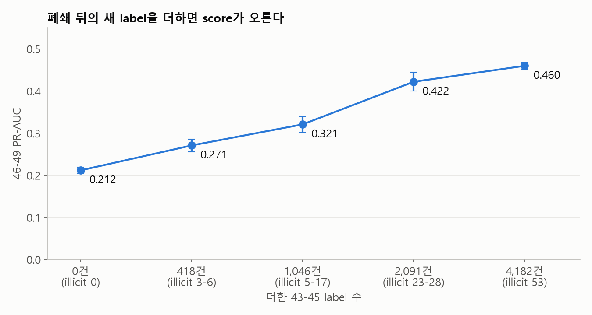
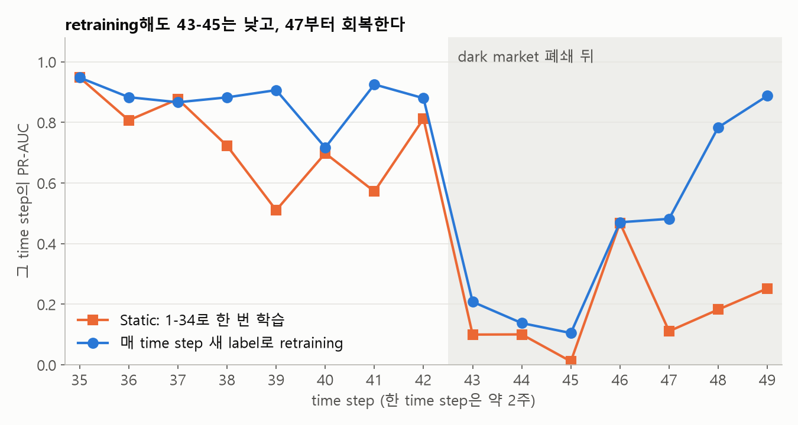
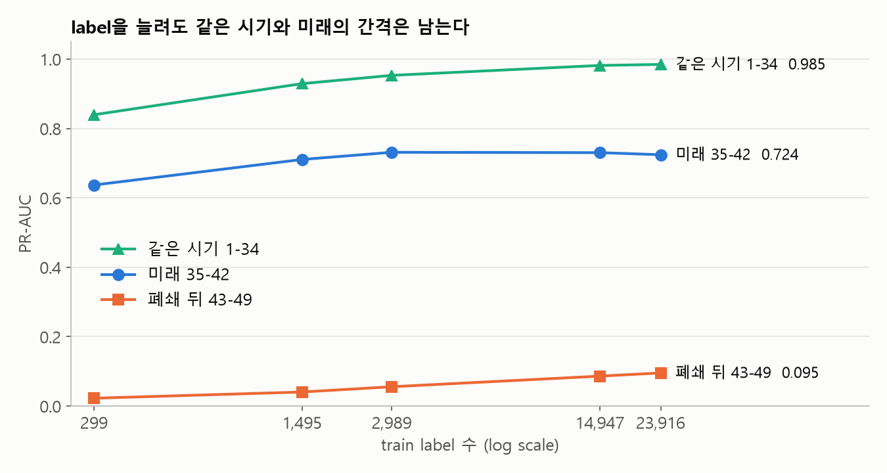
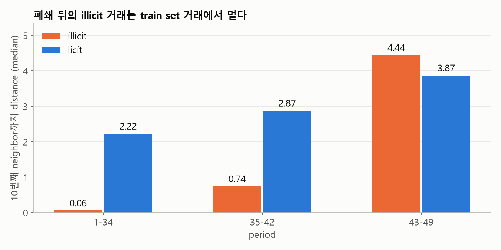

# Transaction-time 정보만으로 Bitcoin illicit 거래 찾기: Unsupervised·Semi-supervised Learning

담당: 팀원 B (E6 unsupervised, E7 semi-supervised, E8-E9 distribution shift) · 2026-11-22

## 결론

**거래가 일어난 순간에 알 수 있는 feature 57개만으로, label 5-10%면 PR-AUC 0.59-0.64까지 탐지한다(random 0.065). label을 100%까지 늘려도 5-10%보다 낫다고 판정되지 않았고, 성능은 시간이 지나면서 떨어진다. 43번째 time step에 dark market이 폐쇄된 뒤에는 크게 떨어지며, 그 뒤의 새 label을 더하면 일부 회복한다.**

<!-- table:headline -->

| 방법 | train label | PR-AUC 35-49 | 95% CI | 폐쇄 전 35-42 | 폐쇄 뒤 43-49 |
|---|---|---|---|---|---|
| Random guess | - | 0.065 | - | 0.092 | 0.025 |
| Unsupervised BIRCH | 0% | **0.299** | 0.156-0.407 | 0.399 | 0.023 |
| LightGBM | 1% | **0.489** | 0.256-0.625 | 0.643 | 0.025 |
| Self-training | 1% | **0.544** | 0.300-0.678 | 0.701 | 0.028 |
| LightGBM | 5% | **0.594** | 0.334-0.727 | 0.736 | 0.050 |
| Self-training | 5% | **0.593** | 0.336-0.728 | 0.748 | 0.047 |
| LightGBM | 10% | **0.624** | 0.365-0.755 | 0.750 | 0.070 |
| Self-training | 10% | **0.635** | 0.387-0.760 | 0.765 | 0.072 |
| LightGBM | 100% | **0.593** | 0.332-0.735 | 0.733 | 0.091 |

<!-- /table -->

1. **label이 없으면 약하다.** unsupervised 8종 중 가장 좋은 BIRCH가 0.299다. random보다는 4.6배 높다.
2. **label은 조금만 있어도 크게 오른다.** train label 1%(299건)로 0.49-0.54가 된다. LightGBM과 Self-training 모두 5-10%(1,495-2,989건)와 label 100%(29,894건) LightGBM의 우열을 판정할 수 없었다.
3. **Self-training의 이득은 label 1%에서만 확인됐다.** 1%에서 LightGBM보다 0.055 ± 0.015 높고, 5%와 10%에서는 판정 불가다. 다른 semi-supervised 방법 중에는 label 100%의 Label Spreading만 기준을 넘었다(4.2절, seed 3개).
4. **model을 더 섞거나 조정해도 일관된 개선은 없었다.** ensemble 2종, LightGBM hyperparameter config 32종, Self-training variant를 시험했다.
5. **폐쇄 뒤에는 illicit 거래의 모양이 바뀐다.** illicit 중 "single-input" 거래가 92%에서 12%로 줄고, 이 group의 illicit probability는 21.9%에서 0.6%가 된다. 옛 data로 배운 규칙이 맞지 않는다.
6. **폐쇄 뒤의 label을 더하면 일부 회복한다.** 46-49 PR-AUC는 1-42 label만으로 0.212다. 43-45 label 418건(그중 illicit 3-6건)을 더하면 0.271, 1,046건이면 0.321, 4,182건 전부면 0.460이다(seed 6개). 새 label 없이 시험한 adjustment 방법 중 35-49 전체 성능을 올린 것은 없었다.

**이론으로 보면:** machine learning은 training data와 예측할 data의 distribution이 같다고 가정한다. 같은 시기의 거래는 적은 label로도 잘 맞히지만, 시기가 다르면 label을 늘려도 간격이 남는다. 43 뒤에는 input과 target의 관계 일부가 뒤집힌 것도 확인된다(8장).

**이 결과를 쓸 때 주의할 점**

- test set(35-49)을 여러 번 보면서 실험했다. 수치가 optimistic일 수 있다.
- 위 성능은 labeled 거래에서 잰 값이다. 전체 거래 흐름에서의 alert 성능이 아니다.
- "판정 불가"는 같다는 뜻이 아니라, 이 data로는 우열을 가릴 수 없다는 뜻이다.

### 읽는 법

| 용어 | 뜻 |
|---|---|
| PR-AUC | illicit일 가능성 순으로 줄 세웠을 때 precision과 recall을 요약한 값(scikit-learn의 Average Precision, trapezoidal AUC와는 다름)이다. 1이 최고이고, random이면 그 period의 illicit ratio와 같다. illicit ratio가 다른 period끼리는 그대로 비교하면 안 된다 |
| precision | illicit이라고 한 것 중 실제 illicit의 비율 |
| recall | 실제 illicit 중 찾아낸 비율 |
| F1 | precision과 recall의 harmonic mean |
| time step | 약 2주 단위. 1부터 49까지 있다 |
| seed | 공개할 label과 model의 random state를 정하는 번호. 여러 seed로 반복해 average한다 |
| ± | seed 사이의 standard error다. standard deviation일 때는 표 아래에 따로 적었다 |
| 95% CI | time step을 통째로 1,000번 다시 뽑아 구한 범위(bootstrap) |
| 판정 | 차이가 t-distribution 95% 기준(seed 6개면 standard error의 2.57배, 3개면 4.30배)을 넘고, 95% CI가 있으면 그것도 0을 포함하지 않을 때만 "높다" 또는 "낮다"로 쓴다 |

## 1. 문제와 data

### 1.1 Input과 output

- **input:** Bitcoin 거래 1건의 feature 57개
- **output:** 그 거래가 illicit일 가능성 score
- **data:** Elliptic Bitcoin. 거래 203,769건이고, 이 중 illicit 4,545건과 licit 42,019건에만 label이 있다. 나머지 157,205건은 label이 없다.

### 1.2 Feature 57개

팀 합의에 따라 거래가 일어난 순간에 알 수 있는 것만 썼다.

| 묶음 | 열 | 개수 | 내용 |
|---|---|---|---|
| Transaction feature | local_0-20 | 21 | 금액, 수수료, input과 output의 수 등 |
| predecessor aggregate | agg_0-35 | 36 | 이 거래가 돈을 받아 온 거래들의 통계 |

나중에야 알 수 있는 address aggregate와 successor aggregate는 넣지 않았다. feature의 의미는 Šafář et al. (2026)의 복원 결과를 따른다.

### 1.3 나누는 방법

거래의 time step 번호로 나눈다. random split이 아니므로 목록은 항상 같다.

| Split | Time step | 전체 거래 | Labeled | illicit | 쓰임 |
|---|---|---|---|---|---|
| Train | 1-30 | 123,287 | 26,905 | 2,954 | model 학습 |
| Validation | 31-34 | 12,978 | 2,989 | 508 | hyperparameter config와 threshold 선택 |
| Test | 35-49 | 67,504 | 16,670 | 1,083 | 평가 |

- hyperparameter config를 고른 뒤 1-34로 다시 학습해 test한다.
- "label 1%"는 1-34의 label 29,894건 중 1%만 학습에 공개한다는 뜻이다.
- test는 dark market 폐쇄 전(35-42)과 폐쇄 뒤(43-49)로도 나눠 본다.

## 2. Data 진단과 preprocessing

### 2.1 Distribution은 normal distribution과 많이 다르다

<!-- table:diagnostics -->

| 진단 (train 1-30) | 값 |
|---|---|
| kurtosis median (normal distribution은 0) | 283 |
| normal distribution에 가까운 feature | 2 / 57 |
| 값의 절반 넘게 한 값에 몰린 feature | 37 / 57 |
| 5 standard deviation을 넘는 outlier가 있는 feature | 37 / 57 |
| time-proxy feature(agg_6/7/9)의 train-test KS | 0.996-0.998 |

<!-- /table -->

- tail이 매우 길어서, outlier 몇 개가 distance 계산을 좌우한다.
- 한 값에 몰린 것은 주로 input이 1개인 거래 때문이다. input이 1개면 input 값의 standard deviation이 0이 되는 식이다. 몰린 값은 어떤 monotonic transform으로도 펼쳐지지 않는다.



**그림 1. train set과 test set의 distribution이 가장 다른 feature 12개.** 막대가 길수록 두 period의 distribution이 다르다. 파란 막대 agg_6, agg_7, agg_9는 선행 거래의 block height로, 시간이 흐르면 계속 커지는 "time-proxy feature"다. "54개 feature"는 이 셋을 뺀 것이다.

### 2.2 Distance-based 방법의 preprocessing

kNN과 Label Spreading은 distance를 쓰므로 preprocessing에 민감하다. train 1-30으로 맞추고 validation 31-34의 PR-AUC를 쟀다(seed 3개, 굵은 글씨는 열마다 최고).

<!-- table:prep_compare -->

| preprocessing | kNN 1% | kNN 10% | kNN 100% | Label Spreading 1% | Label Spreading 10% |
|---|---|---|---|---|---|
| Standardization (57개) | 0.446 | 0.542 | 0.595 | 0.467 | 0.539 |
| Quantile transform (57개) | 0.655 | 0.624 | 0.692 | **0.624** | 0.547 |
| Quantile transform (54개) | **0.688** | 0.716 | 0.696 | 0.477 | 0.626 |
| Log transform (54개) | 0.606 | 0.623 | 0.649 | 0.559 | 0.645 |
| Yeo-Johnson (54개) | 0.628 | 0.645 | 0.709 | 0.572 | **0.711** |
| Mode-value split (54개) | 0.661 | **0.718** | **0.742** | 0.560 | 0.616 |
| Mode-value split + deduplication | 0.632 | 0.660 | 0.739 | 0.509 | 0.600 |

<!-- /table -->

다섯 열 모두 Standardization이 가장 낮다. 어느 transform이 가장 좋은지는 방법과 label 수에 따라 다르다.

### 2.3 Test에서 확인

validation에서 좋았던 두 preprocessing을 기존 Quantile transform(57개)과 비교했다(E7b, seed 3개, test PR-AUC).

<!-- table:embedding -->

| 방법 | distance space | 1% | 5% | 10% | 50% | 100% |
|---|---|---|---|---|---|---|
| Label Spreading | Quantile transform 57개 | 0.370 | 0.571 | 0.562 | 0.607 | 0.629 |
| Label Spreading | Quantile transform 54개 | 0.327 | 0.354 | 0.408 | 0.516 | 0.561 |
| Label Spreading | Yeo-Johnson 54개 | 0.332 | 0.321 | 0.388 | 0.483 | 0.503 |
| Cluster representative | Quantile transform 57개 | 0.432 | 0.585 | 0.626 | - | - |
| Cluster representative | Quantile transform 54개 | 0.291 | 0.542 | 0.636 | - | - |
| Cluster representative | Yeo-Johnson 54개 | 0.377 | 0.568 | 0.627 | - | - |
| Cluster label propagation | Quantile transform 57개 | 0.526 | 0.619 | 0.642 | - | - |
| Cluster label propagation | Quantile transform 54개 | 0.249 | 0.505 | 0.589 | - | - |
| Cluster label propagation | Yeo-Johnson 54개 | 0.500 | 0.541 | 0.571 | - | - |

<!-- /table -->

- 11개 조건 중 10개에서 Quantile transform 57개가 가장 높다. validation에서의 ranking이 뒤집혔다.
- 54개 조건은 time-proxy feature도 빠져 있어, transform의 효과와 feature 제거의 효과가 섞여 있다.
- 이후 실험은 Quantile transform 57개를 쓴다. **test를 보고 내린 post-hoc 결정**이다.

## 3. Unsupervised Learning (E6)

label 없이 anomaly score를 만들고, validation set에서 hyperparameter config와 score 방향을 골랐다. validation label로 골랐으므로 엄밀한 의미의 순수 unsupervised는 아니다.

| detector | score를 만드는 법 | 출처 |
|---|---|---|
| PCA reconstruction | principal component로 줄였다가 되돌린 error | Lec8 |
| Kernel PCA reconstruction | RBF Kernel PCA로 줄였다가 되돌린 input space의 error | Lec8 |
| GMM density | negative log-likelihood | Lec9 |
| GMM component | 속한 component의 volume | Lec9의 GMM을 응용 |
| BIRCH | 가장 가까운 centroid까지의 distance(cluster는 size-weighted K-Means로 묶음) | Lec9를 응용 |
| Isolation Forest | isolation까지의 path length | Lec9 |
| One-Class SVM | decision function | Lec9 |
| HDBSCAN | cluster에서 떨어진 정도 | Campello et al. (2015), 수업 밖 |

BIRCH와 One-Class SVM은 sample 1만 건, HDBSCAN은 2만 건, Kernel PCA는 5천 건으로 학습했다. hyperparameter config 조합은 240개이고, detector마다 validation PR-AUC가 가장 높은 것을 test했다(seed 3개).

<!-- table:unsupervised -->

| detector | preprocessing | validation | test | F1 | precision | recall | 35-42 | 43-49 |
|---|---|---|---|---|---|---|---|---|
| BIRCH | std_notp | 0.566 | **0.299** | 0.398 | 0.602 | 0.297 | 0.399 | 0.023 |
| PCA reconstruction | std_notp | 0.640 | **0.177** | 0.275 | 0.277 | 0.272 | 0.272 | 0.023 |
| GMM component | quantile | 0.408 | **0.156** | 0.263 | 0.164 | 0.668 | 0.237 | 0.022 |
| One-Class SVM | std_notp | 0.452 | **0.149** | 0.176 | 0.175 | 0.177 | 0.234 | 0.025 |
| HDBSCAN | quantile | 0.465 | **0.111** | 0.174 | 0.117 | 0.345 | 0.174 | 0.024 |
| Kernel PCA reconstruction | std_notp | 0.486 | **0.098** | 0.120 | 0.095 | 0.163 | 0.148 | 0.024 |
| Isolation Forest | std | 0.408 | **0.097** | 0.114 | 0.092 | 0.148 | 0.149 | 0.021 |
| GMM density | std | 0.507 | **0.080** | 0.105 | 0.070 | 0.212 | 0.116 | 0.020 |

<!-- /table -->



**그림 2. unsupervised 8종의 test PR-AUC.** 오른쪽으로 길수록 좋다. 점선은 random guess였을 때다.

**방법별 장단점**

| 방법 | 장점 | 단점 |
|---|---|---|
| BIRCH | PR-AUC, F1, precision 모두 8종 중 최고 | illicit의 30%만 찾는다 |
| PCA reconstruction | validation에서 최고(0.640), 단순하고 빠르다 | test에서는 0.177로 떨어진다 |
| GMM component | recall이 0.668로 최고 | precision이 0.164라 false positive가 많다 |
| One-Class SVM | nonlinear boundary를 만든다 | PR-AUC 0.149, 큰 data에서 느려 sample로 학습한다 |
| HDBSCAN | cluster 수를 정하지 않아도 된다 | precision 0.117 |
| Kernel PCA reconstruction | nonlinear 구조를 본다 | 0.098, sample로 학습한다 |
| Isolation Forest | 큰 data에 빠르다 | PR-AUC가 0.097로 낮다 |
| GMM density | probabilistic model이라 해석이 쉽다 | 0.080으로 random에 가깝다 |

8종 모두 validation에서 고른 score 방향이 **반대**였다. anomaly score가 낮은 거래일수록 illicit이었다. 관련 현상을 8.5절에서 확인한다.

## 4. Semi-supervised Learning (E7)

### 4.1 방법

train label의 1, 5, 10, 50, 100%만 공개하고 나머지는 unlabeled data로 썼다. classifier는 team config의 LightGBM이다.

| 방법 | 하는 일 | 출처 |
|---|---|---|
| LightGBM | 공개된 label만으로 학습한다(baseline) | 팀 E2 |
| LightGBM (54개 feature) | time-proxy feature 3개를 뺀다 | 2.1절 |
| Self-training | probability 0.95 이상으로 확신한 거래에 pseudo-label을 붙여 다시 학습한다(최대 5회) | scikit-learn |
| Label Spreading | 가까운 거래끼리 이은 kNN graph로 label을 퍼뜨린다 | scikit-learn `LabelSpreading` |
| Cluster representative | cluster마다 centroid에 가까운 1건에만 label을 붙인다 | Lec9 32쪽 |
| Cluster label propagation | representative의 label을 cluster에서 가까운 20%에 퍼뜨린다. Label Spreading과 다른 방법이다 | Lec9 33쪽 |
| Active learning | model이 가장 헷갈리는 거래부터 label을 요청한다 | Lorenz et al. (2020) |

### 4.2 전체 방법 비교

seed 3개의 test PR-AUC다.

<!-- table:e7_prauc -->

| 방법 | 1% | 5% | 10% | 50% | 100% |
|---|---|---|---|---|---|
| LightGBM | 0.543 ± 0.022 | 0.603 ± 0.033 | 0.627 ± 0.015 | 0.621 ± 0.031 | 0.603 ± 0.010 |
| LightGBM (54개 feature) | 0.537 ± 0.059 | 0.585 ± 0.035 | 0.594 ± 0.025 | 0.602 ± 0.013 | 0.590 ± 0.003 |
| Self-training | 0.589 ± 0.012 | 0.629 ± 0.039 | 0.645 ± 0.024 | 0.643 ± 0.038 | 0.564 ± 0.019 |
| Label Spreading | 0.370 ± 0.126 | 0.571 ± 0.023 | 0.562 ± 0.041 | 0.607 ± 0.036 | 0.629 ± 0.007 |
| Cluster representative | 0.475 ± 0.056 | 0.630 ± 0.031 | 0.643 ± 0.016 | - | - |
| Cluster label propagation | 0.539 ± 0.056 | 0.623 ± 0.011 | 0.618 ± 0.041 | - | - |
| Active learning | 0.563 ± 0.058 | 0.491 ± 0.068 | 0.549 ± 0.017 | - | - |

<!-- /table -->

(± 는 standard deviation. cluster 방법은 빈 cluster 때문에 10%에서 2,983-2,987건을 썼다)

같은 seed끼리 LightGBM과 비교해 판정 기준을 넘은 것은 셋뿐이다. Label Spreading 100%가 높고, Active learning 10%와 54개 feature 10%가 낮다. 나머지 차이는 판정 불가다.



**그림 3. label ratio에 따른 test PR-AUC.** 칸마다 한 방법(파랑)을 LightGBM(회색)과 비교한다. 파란 선이 위에 있으면 그 방법의 mean이 높다. error bar는 seed standard deviation으로, 길면 결과가 불안정하다는 뜻이다.

**방법별 장단점**

| 방법 | 장점 | 단점 |
|---|---|---|
| Self-training | label 1%에서 가장 높다 | 100%에서는 LightGBM보다 낮고, 학습이 10배 넘게 느리다 |
| Label Spreading | 100%에서 가장 높다 | 1%에서 0.370으로 가장 낮고 가장 불안정하다 |
| Cluster representative | 5-10%에서 mean이 높은 편이다 | 1%에서 낮고, 실행 환경에 따라 0.10까지 달라진다 |
| Cluster label propagation | 1%에서 Cluster representative보다 높다 | 5-10%에서 일관된 이득이 없고, 실행 환경에 민감하다 |
| Active learning | 같은 예산으로 illicit label을 더 많이 모은다 | 5-10%에서 LightGBM보다 낮다 |
| 54개 feature | 명시적인 시간 정보를 덜 쓴다 | 모든 label ratio에서 mean이 낮다 |

### 4.3 F1, precision, recall

threshold는 0.05-0.95를 0.01 간격으로 나눈 91개 후보 중 validation F1이 가장 높은 것이다. 칸은 F1 (precision / recall)이다.

<!-- table:e7_f1 -->

| 방법 | 1% | 5% | 10% |
|---|---|---|---|
| LightGBM | 0.547 (0.63 / 0.50) | 0.568 (0.75 / 0.46) | 0.508 (0.70 / 0.45) |
| Self-training | 0.593 (0.75 / 0.50) | 0.600 (0.82 / 0.47) | 0.578 (0.83 / 0.46) |
| Label Spreading | 0.267 (0.36 / 0.36) | 0.525 (0.61 / 0.52) | 0.556 (0.69 / 0.48) |
| Cluster representative | 0.423 (0.55 / 0.41) | 0.592 (0.76 / 0.48) | 0.597 (0.82 / 0.47) |

<!-- /table -->

위 값은 threshold를 정할 때 validation label을 전부 썼다. validation label도 같은 ratio만 있다고 가정하면 다음과 같다(E7b).

<!-- table:threshold -->

| 방법 | threshold를 정한 label | 1% | 5% | 10% | 50% | 100% |
|---|---|---|---|---|---|---|
| LightGBM | validation label 전부 | 0.547 | 0.568 | 0.508 | 0.552 | 0.559 |
| LightGBM | 같은 ratio만 | 0.479 | 0.560 | 0.523 | 0.574 | 0.559 |
| Self-training | validation label 전부 | 0.593 | 0.599 | 0.578 | 0.593 | 0.549 |
| Self-training | 같은 ratio만 | 0.590 | 0.601 | 0.601 | 0.587 | 0.549 |

<!-- /table -->

Self-training의 F1은 0.03 안에서만 바뀐다. LightGBM은 1%에서 0.07 낮아진다.

### 4.4 Seed 6개로 다시 잰 대표 비교

Self-training과 LightGBM은 seed 6개로 늘려 비교했다. 여기부터 Self-training은 variant 실험이 가능한 자체 구현이며, unlabeled 거래를 3만 건까지 쓴다(4.2절은 scikit-learn, 6만 건). 반복 절차(마지막 retraining 포함)가 scikit-learn과 같은지는 synthetic data로 확인했다. probability가 정확히 0.95인 거래를 포함하는지만 다르다. 대표 평가는 저장된 예측(float32)으로 다시 계산해, 실행 직후 기록과 소수 셋째 자리에서 다를 수 있다.



**그림 4. train label 양과 test PR-AUC.** 왼쪽에서 오른쪽으로 label이 많아진다. 5% 뒤로 평평하면 label을 더 줘도 얻는 것이 적다는 뜻이다. error bar는 standard error다.

**Self-training이 LightGBM보다 나은가**

<!-- table:st_vs_lgbm -->

| 비교 (앞 - 뒤) | 차이 ± standard error | 95% CI | 판정 |
|---|---|---|---|
| Self-training 1% - LightGBM 1% | +0.055 ± 0.015 | 0.033에서 0.076 | **높다** |
| Self-training 5% - LightGBM 5% | -0.001 ± 0.010 | -0.025에서 0.026 | 판정 불가 |
| Self-training 10% - LightGBM 10% | +0.012 ± 0.011 | -0.008에서 0.031 | 판정 불가 |

<!-- /table -->

**적은 label과 label 100%의 차이**

<!-- table:few_vs_all -->

| 비교 (앞 - 뒤) | 차이 ± standard error | 95% CI | 판정 |
|---|---|---|---|
| LightGBM 1% - LightGBM 100% | -0.104 ± 0.045 | -0.176에서 -0.023 | 판정 불가 |
| LightGBM 5% - LightGBM 100% | +0.001 ± 0.010 | -0.060에서 0.051 | 판정 불가 |
| LightGBM 10% - LightGBM 100% | +0.031 ± 0.010 | -0.018에서 0.077 | 판정 불가 |
| Self-training 1% - LightGBM 100% | -0.048 ± 0.032 | -0.129에서 0.043 | 판정 불가 |
| Self-training 5% - LightGBM 100% | +0.001 ± 0.016 | -0.074에서 0.061 | 판정 불가 |
| Self-training 10% - LightGBM 100% | +0.043 ± 0.014 | -0.012에서 0.091 | 판정 불가 |

<!-- /table -->

## 5. 성능을 올리려고 시도한 것

### 5.1 LightGBM hyperparameter config 32종

Base hyperparameter 4종, 최근 거래 weight 4종, unsupervised score feature 유무의 모든 조합이다(E7c, seed 3개).

<!-- table:lgbm_variants -->

| 바꾼 것 | test PR-AUC (1/5/10% mean) |
|---|---|
| Base hyperparameter | team config 0.569, small 0.560, balanced 0.565, shallow 0.557 |
| 최근 거래 weight | 없음 0.569, half-life 20 0.565, half-life 10 0.562, half-life 5 0.555 |
| unsupervised score feature | 없음 0.576, 있음 0.550 |

<!-- /table -->

team config, weight 없음, unsupervised score 없음이 각각 가장 높았다.

### 5.2 Self-training variant

team config 위에서 기본(threshold 0.95)과의 차이다(seed 3개).

<!-- table:st_variants -->

| variant (기본은 threshold 0.95) | 1% | 5% | 10% |
|---|---|---|---|
| illicit 0.7 / licit 0.95 | -0.036 ± 0.019 | +0.017 ± 0.003 | +0.003 ± 0.009 |
| illicit 0.85 / licit 0.95 | -0.022 ± 0.011 | +0.017 ± 0.004 | -0.002 ± 0.009 |
| threshold 0.9 | -0.026 ± 0.015 | +0.010 ± 0.008 | -0.009 ± 0.008 |
| threshold 0.9, weight 0.5 | -0.028 ± 0.017 | +0.004 ± 0.004 | -0.016 ± 0.008 |
| threshold 0.99 | +0.028 ± 0.012 | -0.004 ± 0.014 | 0.000 ± 0.008 |
| illicit 0.7 / licit 0.95, class balancing | -0.170 ± 0.054 | -0.095 ± 0.065 | -0.036 ± 0.044 |
| illicit 0.85 / licit 0.95, class balancing | -0.165 ± 0.041 | -0.105 ± 0.054 | -0.065 ± 0.051 |
| threshold 0.9, class balancing | -0.167 ± 0.067 | -0.099 ± 0.045 | -0.059 ± 0.052 |
| threshold 0.9, class balancing, weight 0.5 | -0.159 ± 0.058 | -0.084 ± 0.056 | -0.055 ± 0.042 |
| threshold 0.95, class balancing | -0.184 ± 0.072 | -0.083 ± 0.031 | -0.082 ± 0.038 |
| threshold 0.99, class balancing | -0.237 ± 0.083 | -0.092 ± 0.051 | -0.063 ± 0.038 |

<!-- /table -->

- class balancing을 적용한 pseudo-label은 모든 조건에서 mean이 낮다.
- 5%에서 illicit threshold를 낮춘 variant가 +0.017로 높은 편이지만 1%와 10%에서는 이어지지 않는다. 1%의 threshold 0.99(+0.028)는 판정 기준에 못 미친다. 33개 비교 중 일부라 우연일 수 있어 채택하지 않았다.

### 5.3 Test time step의 unlabeled 거래로 adaptation

time step t를 예측할 때 t까지의 unlabeled 거래를 Self-training에 넣었다(E7d, seed 3개). t 뒤의 거래는 쓰지 않는다.

<!-- table:test_time_st -->

| label | 35-49 static | 35-49 adaptive | 43-49 static | 43-49 adaptive |
|---|---|---|---|---|
| 1% | 0.593 | 0.583 | 0.030 | 0.031 |
| 5% | 0.633 | 0.600 | 0.058 | 0.061 |
| 10% | 0.638 | 0.642 | 0.075 | 0.070 |

<!-- /table -->

label ratio 전반에서 일관된 개선이 없다.

### 5.4 Hyperparameter config를 고르는 규칙

single model hyperparameter config 57개에서, validation score가 test ranking을 얼마나 맞히는지 봤다. correlation은 1이면 완전히 맞힌다.

<!-- table:selection -->

| hyperparameter config를 고르는 규칙 | test ranking과의 correlation | 고른 hyperparameter config의 test PR-AUC |
|---|---|---|
| validation 31-34 하나 | 0.45 | 0.584 |
| Rolling-origin validation 3개 mean | 0.42 | 0.549 |

<!-- /table -->

어느 규칙도 강하지 않다. validation 31-34는 train set 바로 뒤라 먼 미래를 대표하지 못한다.

## 6. Ensemble

Self-training, LightGBM, Label Spreading을 합쳤다. 미래 time step을 쓰지 않도록 두 규칙을 썼다.

- **Past-only rank averaging:** time step t에서 35부터 t까지의 score로만 ranking을 매겨 average한다.
- **Soft voting:** 세 model의 probability를 그대로 average한다(Lec7 12쪽).

<!-- table:ensemble_scores -->

| 방법 | 1% | 5% | 10% |
|---|---|---|---|
| LightGBM | 0.489 | 0.594 | 0.624 |
| Self-training | 0.544 | 0.593 | 0.635 |
| Ensemble (past-only rank) | 0.517 | 0.581 | 0.605 |
| Ensemble (soft voting) | 0.553 | 0.600 | 0.633 |

<!-- /table -->

<!-- table:ensemble_vs_st -->

| 비교 (앞 - 뒤) | 차이 ± standard error | 95% CI | 판정 |
|---|---|---|---|
| Ensemble (past-only rank) 1% - Self-training 1% | -0.027 ± 0.018 | -0.097에서 0.024 | 판정 불가 |
| Ensemble (past-only rank) 5% - Self-training 5% | -0.013 ± 0.009 | -0.071에서 0.039 | 판정 불가 |
| Ensemble (past-only rank) 10% - Self-training 10% | -0.030 ± 0.004 | -0.107에서 0.023 | 판정 불가 |
| Ensemble (soft voting) 1% - Self-training 1% | +0.009 ± 0.017 | -0.021에서 0.032 | 판정 불가 |
| Ensemble (soft voting) 5% - Self-training 5% | +0.007 ± 0.011 | -0.016에서 0.037 | 판정 불가 |
| Ensemble (soft voting) 10% - Self-training 10% | -0.002 ± 0.007 | -0.038에서 0.042 | 판정 불가 |

<!-- /table -->

**ensemble이 Self-training보다 낫다는 근거는 없다.** 구성이 더 복잡하므로 single model을 권한다.

## 7. 43번째 time step 이후

### 7.1 무슨 일이 있었나

dark market은 Tor 같은 익명망으로만 접속하는 불법 온라인 장터이고, 결제에 주로 Bitcoin을 쓴다. data를 공개한 Weber et al. (2019)은 43번째 time step에 큰 dark market이 폐쇄됐다고 설명한다. 장터의 이름과 실제 날짜는 공개되지 않았다.

### 7.2 무엇이 바뀌었나

"single-input 거래"는 local_3(input 수)이 train set의 mode인 거래다.

<!-- table:shift -->

| period | illicit 중 single-input | licit 중 single-input | single-input의 illicit probability | multi-input의 illicit probability |
|---|---|---|---|---|
| 1-34 | 92.3% | 43.0% | 21.9% | 1.7% |
| 35-42 | 91.1% | 67.3% | 12.0% | 2.7% |
| 43-49 | 11.8% | 53.9% | 0.6% | 4.7% |

<!-- /table -->



**그림 5. 두 group의 illicit probability.** 파랑은 학습 때, 청록은 "전체 illicit ratio만 줄었다면" 나왔을 값, 주황은 실제다. 주황이 청록과 다르면 prior 외의 것이 바뀌었다는 뜻이다.

- **새로운 패턴이 갑자기 생긴 것만은 아니다.** 폐쇄 뒤 illicit의 80%가 속한 cluster 3개는 1-34에도 있었고, 당시 illicit의 4.8%(167건)였다.
- **그때는 배우기 어려운 영역이었다.** 그 cluster에 있던 train set 거래의 98.6%가 licit이었다.
- **예전 주류는 사라졌다.** 1-34 illicit의 65%를 차지하던 cluster 5개에는 43 이후 illicit이 한 건도 없다.

cluster는 test label까지 보고 만든 post-hoc 분석이며 예측에는 쓰지 않았다.

### 7.3 새 label 없이 바로잡을 수 있나

time-proxy feature를 뺀 54개로, 새 label 없이 adjustment를 적용했다(E9, train label 100%, seed 3개). adjustment는 time step별 거래 묶음 단위로 한다.

| 방법 | 하는 일 |
|---|---|
| Within-group ranking | single-input과 multi-input group 안에서 따로 ranking을 매겨 합친다 |
| EM prior adjustment | label 없이 group별 illicit ratio를 추정해 score를 고친다 (Saerens et al. 2002) |
| Calibration + EM | probability를 먼저 calibration한 뒤 EM을 쓴다 |
| EM shrinkage | EM estimate를 train prior 쪽으로 당긴다 |
| Reference-prior EM | 최근 10개 train time step에서 추정한 prior와의 차이만큼 고친다 |
| input-structure feature 제거 | "single-input"을 나타내는 feature 17개를 뺀다 |
| Hedge | Baseline model과 multi-input specialist model을 섞는다 |

<!-- table:no_label_fixes -->

| 방법 | 35-42 | 43-49 | 35-49 전체 | train 1-42, test 43-49 |
|---|---|---|---|---|
| Baseline model | 0.721 | 0.086 | 0.599 | 0.138 |
| Within-group ranking | 0.632 | 0.126 | 0.507 | 0.240 |
| EM prior adjustment | 0.588 | 0.166 | 0.489 | 0.373 |
| Calibration + EM | 0.130 | 0.331 | 0.131 | 0.462 |
| EM shrinkage | 0.672 | 0.129 | 0.564 | 0.248 |
| Reference-prior EM | 0.488 | 0.138 | 0.381 | 0.072 |
| input-structure feature 제거 | 0.712 | 0.092 | 0.593 | 0.159 |
| Hedge (past-only rank) | 0.622 | 0.105 | 0.473 | 0.234 |
| Hedge (soft voting) | 0.702 | 0.097 | 0.577 | 0.201 |

<!-- /table -->

- 35-49 전체에서 Baseline model보다 높은 방법은 없다.
- 대부분 폐쇄 뒤를 올리는 대신 폐쇄 전을 내준다. Calibration + EM은 폐쇄 뒤 0.331로 오르지만 폐쇄 전이 0.130으로 무너진다.
- 언제 바뀔지 모른다면 쓰기 어렵다. 이것이 모든 label-free 방법의 불가능을 뜻하지는 않는다.

### 7.4 새 label을 넣으면 회복하나

43-45의 label을 더하고 46-49로 평가했다(E8, LightGBM, seed 6개). 1-42의 label 39,877건은 전부 쓴다. 판정은 seed 변동만 반영하며, 46-49라는 한 기간의 uncertainty는 반영하지 않는다.

<!-- table:recovery -->

| training data | 새 label | 그중 illicit | 46-49 PR-AUC | 기준과의 차이 | 판정 |
|---|---|---|---|---|---|
| 1-34 | 0 | 0 | 0.160 | -0.052 ± 0.006 | **낮다** |
| 1-42 (기준) | 0 | 0 | 0.212 | - | - |
| 1-42 + 43-45의 10% | 418 | 3-6 | 0.271 | +0.059 ± 0.019 | **높다** |
| 1-42 + 43-45의 25% | 1,046 | 5-17 | 0.321 | +0.109 ± 0.022 | **높다** |
| 1-42 + 43-45의 50% | 2,091 | 23-28 | 0.422 | +0.210 ± 0.016 | **높다** |
| 1-42 + 43-45 전부 | 4,182 | 53 | 0.460 | +0.248 ± 0.009 | **높다** |
| 43-45만 | 4,182 | 53 | 0.430 | +0.218 ± 0.016 | **높다** |

<!-- /table -->



**그림 6. 더한 43-45 label 수와 46-49 PR-AUC.** 맨 왼쪽은 1-42만 쓴 기준이다. 괄호는 그중 illicit 수이고, error bar는 standard error다.

매 time step 직전까지의 label로 다시 학습하면 다음과 같다. label이 바로 들어온다고 가정한 upper bound며, 칸은 time step별 PR-AUC의 mean이다.

<!-- table:rolling -->

| Training 방식 | 35-42 | 43-45 | 47-49 | 43-49 |
|---|---|---|---|---|
| Static (1-34) | 0.743 | 0.071 | 0.182 | 0.175 |
| 매 time step retraining (expanding window) | 0.876 | 0.150 | 0.717 | 0.439 |
| 매 time step retraining (sliding window 10) | 0.883 | 0.149 | 0.807 | 0.448 |

<!-- /table -->



**그림 7. time step별 PR-AUC.** 주황은 한 번만 학습한 model, 파랑은 매 time step 다시 학습한 model이다. 회색 배경이 폐쇄 뒤다. 46은 illicit이 2건뿐이라 값이 흔들린다.

- 바로 뒤(43-45)는 retraining해도 낮다. 새 패턴의 label이 아직 거의 없다.
- 4개 time step(약 8주) 뒤인 47부터 회복한다.

### 7.5 옛 label도 적을 때 (E8b)

1-42의 label을 10%만 쓰고 43-45 label을 더했다(seed 3개, 46-49 PR-AUC).

<!-- table:shift_ssl -->

| 새 label | LightGBM | Self-training | Label Spreading | Ensemble (soft voting) | Self-training - LightGBM |
|---|---|---|---|---|---|
| 0 | 0.140 | 0.131 | 0.062 | 0.076 | -0.009 ± 0.007 |
| 418 | 0.178 | 0.176 | 0.098 | 0.101 | -0.002 ± 0.041 |
| 1,046 | 0.268 | 0.285 | 0.124 | 0.129 | +0.017 ± 0.028 |
| 2,091 | 0.344 | 0.331 | 0.127 | 0.139 | -0.013 ± 0.019 |

<!-- /table -->

새 label이 많을수록 LightGBM과 Self-training이 오른다. 둘의 차이는 어느 조건에서도 판정할 수 없다. 폐쇄 뒤에는 Label Spreading이 약해서 이를 섞은 ensemble도 낮다.

## 8. 왜 이런 결과가 나오나: machine learning 이론으로 본 해석

이 장은 결과를 본 뒤, 이론이 맞다면 보여야 할 현상을 같은 data에서 확인한 것이다. 이론과 일치한다는 뜻이지 독립된 증명은 아니다.

| 결과 | 설명하는 개념 | 강의 자료 |
|---|---|---|
| label 5-10% 뒤로 오르지 않는다 | learning curve | Lec4 38-44쪽 |
| 43 뒤에 성능이 떨어진다 | nonrepresentative training data, distribution shift | Lec1 39쪽 |
| Self-training은 1%에서만 이득이다 | semi-supervised learning의 가정 | Lec9 33-34쪽 |
| ensemble 이득이 없다 | error의 independence | Lec7 10쪽 |
| anomaly score의 방향이 반대다 | anomaly detection의 density 가정 | Lec9 52쪽 |
| 폐쇄 뒤 PR-AUC가 특히 낮다 | rare positive class와 PR curve | Lec3 24쪽 |

### 8.1 Label을 늘려도 멈추는 이유

**이론:** learning curve가 평평해지면, 같은 distribution의 data를 더 넣어도 얻는 것이 적다는 뜻이다. 예측할 data의 distribution이 학습과 다르면, training data가 많아도 그 차이는 메워지지 않을 수 있다.

**확인:** 같은 LightGBM을 같은 시기(1-34에서 random으로 떼어 둔 20%)와 미래에서 각각 채점했다(seed 6개). 칸은 PR-AUC / ROC-AUC다.

<!-- table:learning_curve -->

| train label 수 | 같은 시기 (1-34) | 미래 35-42 | 폐쇄 뒤 43-49 |
|---|---|---|---|
| 299 | 0.840 / 0.946 | 0.637 / 0.885 | 0.023 / 0.453 |
| 1,495 | 0.929 / 0.982 | 0.711 / 0.910 | 0.040 / 0.676 |
| 2,989 | 0.953 / 0.989 | 0.731 / 0.920 | 0.056 / 0.744 |
| 14,947 | 0.982 / 0.997 | 0.730 / 0.924 | 0.086 / 0.827 |
| 23,916 | 0.985 / 0.997 | 0.724 / 0.927 | 0.095 / 0.849 |

<!-- /table -->



**그림 8. train label 수와 PR-AUC.** 세 선은 같은 model을 다른 period에서 채점한 것이다.

- 같은 시기에서는 label 약 3천 건이면 0.95에 이른다.
- 35-42에서는 0.73 안팎에서 멈춘다.
- 43-49는 label을 늘리면 PR-AUC가 0.023에서 0.095로, ROC-AUC가 0.45에서 0.85로 오른다. 옛 label도 도움은 되지만 같은 시기 수준에는 못 미친다.
- period마다 illicit ratio가 달라서(11.6%, 9.2%, 2.5%) PR-AUC 간격에는 그 효과가 섞인다. class별 score distribution이 같다면 illicit ratio만으로는 변하지 않는 ROC-AUC에서도 간격이 남는다.
- 같은 시기 score는 비슷한 거래가 학습과 평가에 함께 들어가 optimistic이다. 그래서 간격 전부를 distribution shift의 몫이라고 할 수는 없다. 성능 수치로도 쓰지 않는다.

### 8.2 43 뒤에 떨어지는 이유

**이론:** distribution shift는 무엇이 그대로인지로 구분한다(X는 input, Y는 target).

| 종류 | 바뀌는 것 | 그대로인 것 |
|---|---|---|
| Covariate shift | input의 distribution P(X) | 같은 input의 target probability P(Y\|X) |
| Prior shift (label shift) | illicit ratio P(Y) | class 안의 input distribution P(X\|Y) |
| Concept drift | 같은 input의 target probability P(Y\|X) | 정해진 것 없음 |

**확인:** illicit ratio만 11.6%에서 2.5%로 바뀌었다면 두 group의 probability가 함께 내려가야 한다.

<!-- table:label_shift -->

| group | 1-34 illicit probability | prior만 바뀌었을 때 예상 | 43-49 실제 |
|---|---|---|---|
| single-input | 21.9% | 5.3% | **0.6%** |
| multi-input | 1.7% | 0.3% | **4.7%** |

<!-- /table -->

- 한쪽은 예상보다 더 내려가고 다른 쪽은 오히려 올랐다. prior 변화만으로는 설명되지 않는다.
- "single-input인가" 하나로 ranking을 매기면 ROC-AUC가 0.747에서 0.290으로 바뀐다. 0.5보다 낮으므로 규칙의 방향이 뒤집힌 것이다.
- 따라서 **input 수 group 기준으로는 target probability가 바뀌었다.** 57개 feature 전체를 조건으로 한 concept drift인지는 확정하지 못했다.
- 추가 가정이 없으면 이런 변화는 label 없이 일반적으로 알아낼 수 없다. input distribution이 같아도 target probability는 다를 수 있기 때문이다. 새 label이 효과를 낸 7.4절과 맞는다.

### 8.3 Self-training이 1%에서만 이득인 이유

**이론:** Self-training은 확신하는 예측이 대체로 맞다고 가정한다. 이 가정이 깨지면 해로울 수 있고, 맞더라도 새로 배울 것이 있어야 이득이 난다.

**확인:** 공개 label로 한 번 학습한 LightGBM이 probability 0.95 이상(illicit) 또는 0.05 이하(licit)로 확신한 예측이 맞는지, 따로 둔 평가 거래에서 쟀다(seed 6개). 실제 반복 중에 붙은 pseudo-label을 잰 것은 아니다.

<!-- table:pseudo -->

| model의 label | Evaluation period | illicit으로 확신한 것 중 실제 illicit | 실제 illicit 중 licit으로 확신 |
|---|---|---|---|
| 1% | 같은 시기 | 95.3% | 23.1% |
| 1% | 미래 35-42 | 82.8% | 33.2% |
| 1% | 폐쇄 뒤 43-49 | 0.3% | 94.3% |
| 10% | 같은 시기 | 97.5% | 12.0% |
| 10% | 미래 35-42 | 94.1% | 38.2% |
| 10% | 폐쇄 뒤 43-49 | 3.3% | 89.3% |

<!-- /table -->

- label 1% model도 같은 시기에서는 illicit이라는 확신이 대부분 맞는다. Self-training의 가정과 맞는 조건이다.
- 10%에서는 같은 시기 PR-AUC가 이미 0.95라 더 배울 것이 적었을 수 있다. 다만 이것은 hypothesis다. 실제 pseudo-label을 재지 않았으므로 1%에서만 이득인 원인까지 확인한 것은 아니다.
- 폐쇄 뒤에는 illicit이라는 확신이 거의 다 틀리고, 실제 illicit의 대부분을 licit으로 확신한다. test time step의 거래로 적응해도(5.3절) 좋아지지 않은 것과 맞는다.

### 8.4 Ensemble 이득이 없는 이유

**이론:** ensemble은 각 model이 충분히 좋고 서로 다른 실수를 할 때 좋아지기 쉽다. 보장되는 것은 아니며 합치는 규칙과 metric에 따라 다르다.

**확인:** model끼리 error(score - target)의 correlation을 쟀다(seed 6개).

<!-- table:error_corr -->

| label | Self-training과 LightGBM | Self-training과 Label Spreading | LightGBM과 Label Spreading | Label Spreading 단독 PR-AUC |
|---|---|---|---|---|
| 1% | 0.89 | 0.66 | 0.64 | 0.410 |
| 5% | 0.93 | 0.72 | 0.69 | 0.509 |
| 10% | 0.92 | 0.77 | 0.72 | 0.568 |

<!-- /table -->

Self-training과 LightGBM은 probability error의 correlation이 높다. Label Spreading은 correlation이 낮은 대신 단독 성능이 낮다. ensemble 이득이 없는 것과 맞는 현상이지만, PR-AUC에 중요한 top ranking의 보완성을 직접 잰 것은 아니어서 원인으로 확정하지 않는다.

### 8.5 Unsupervised의 score 방향이 반대인 것과 맞는 현상

**이론:** 많은 anomaly detection은 density가 낮은 곳에 있거나 학습한 구조에서 벗어난 것을 anomaly로 본다.

**확인:** 각 거래에서 train set 거래(random 3만 건) 중 10번째로 가까운 것까지 distance를 쟀다. 작을수록 과거에 비슷한 거래가 많다.

<!-- table:distance -->

| period | illicit | licit | distance로 illicit을 맞히는 ROC-AUC |
|---|---|---|---|
| 1-34 | 0.06 | 2.22 | 0.197 |
| 35-42 | 0.74 | 2.87 | 0.315 |
| 43-49 | 4.44 | 3.87 | 0.568 |

<!-- /table -->



**그림 9. 10번째 neighbor까지 distance의 median.** 낮을수록 train set에 비슷한 거래가 많다.

- train set의 illicit은 licit보다 neighbor가 훨씬 가깝다. anomaly score가 낮을수록 illicit인 것과 맞는다.
- 폐쇄 뒤의 illicit은 과거 거래에서 멀다. 학습 때 정한 방향을 쓰는 unsupervised가 함께 나빠지는 것과 맞는다. 폐쇄 뒤 거래끼리의 density나 8종 각각의 실패 원인까지 잰 것은 아니다.

### 8.6 폐쇄 뒤 PR-AUC가 특히 낮은 이유

**이론:** class별 score distribution이 그대로이고 positive ratio만 줄면, PR-AUC는 떨어지고 ROC-AUC는 그대로다.

**확인:** illicit ratio는 35-42에서 9.2%, 43-49에서 2.5%다.

<!-- table:roc_auc -->

| 방법 | ROC-AUC 35-42 | ROC-AUC 43-49 |
|---|---|---|
| LightGBM 1% | 0.883 | 0.467 |
| Self-training 1% | 0.885 | 0.504 |
| LightGBM 10% | 0.923 | 0.786 |
| Self-training 10% | 0.931 | 0.802 |

<!-- /table -->

ROC-AUC도 떨어졌으므로 prior만의 문제는 아니다. 그래도 label 10% model은 폐쇄 뒤에 ranking 성능이 일부 남는다. 다만 illicit이 드물어 적은 false positive에도 precision이 크게 떨어진다. label 1% model은 ranking 성능 자체가 random(0.5) 가까이로 떨어진다.

## 9. 실제로 쓴다면

### 9.1 Time step마다 top-100을 조사할 때

labeled 거래 안에서만 ranking을 매긴 값이다. 실제로는 unlabeled 거래 50,834건도 함께 경쟁하므로 그대로 기대하면 안 된다.

<!-- table:topk -->

| 방법 | 35-42 recall | 35-42 precision | 43-49 recall | 43-49 precision |
|---|---|---|---|---|
| Unsupervised BIRCH 0% | 0.344 | 0.393 | 0.028 | 0.007 |
| LightGBM 1% | 0.517 | 0.590 | 0.106 | 0.025 |
| Self-training 1% | 0.554 | 0.633 | 0.120 | 0.029 |
| LightGBM 10% | 0.529 | 0.605 | 0.372 | 0.090 |
| Self-training 10% | 0.558 | 0.637 | 0.393 | 0.095 |
| Ensemble (past-only rank) 10% | 0.580 | 0.663 | 0.433 | 0.105 |
| Ensemble (soft voting) 10% | 0.587 | 0.671 | 0.298 | 0.072 |
| LightGBM 100% | 0.537 | 0.613 | 0.407 | 0.098 |

<!-- /table -->

### 9.2 Probability를 그대로 믿어도 되나

seed별로 잰 뒤 average했다. ECE(Expected Calibration Error)는 예측 probability와 실제 illicit ratio의 mean 차이로, 0이면 완벽하다.

<!-- table:calibration -->

| model | ECE | 35-42 예측 / 실제 | 43-49 예측 / 실제 |
|---|---|---|---|
| LightGBM 1% | 0.045 | 0.061 / 0.092 | 0.023 / 0.025 |
| Self-training 1% | 0.044 | 0.053 / 0.092 | 0.009 / 0.025 |
| LightGBM 10% | 0.037 | 0.056 / 0.092 | 0.015 / 0.025 |
| Self-training 10% | 0.040 | 0.052 / 0.092 | 0.008 / 0.025 |
| LightGBM 100% | 0.031 | 0.074 / 0.092 | 0.050 / 0.025 |

<!-- /table -->

기간이 바뀌면 예측 probability의 mean이 실제 illicit ratio를 따라가지 못하므로, fixed probability threshold를 오래 쓰기 어렵다.

### 9.3 권장

1. **label이 1% 수준이면** Self-training을 쓴다.
2. **5-10%면** 단순한 LightGBM으로 시작한다. 이 범위에서 Self-training의 이득이 확인되지 않았다.
3. **운영 중에는** feature distribution과 alert의 precision을 감시하고, 바뀌면 새 time step의 label을 모아 다시 학습한다.

## 10. 한계

- **test를 여러 번 봤다.** time-proxy feature의 유지와 ensemble 구성은 test 결과를 보고 정했다. seed를 늘리거나 bootstrap을 해도 이 bias는 없어지지 않는다.
- **test 기간이 하나다.** PR-AUC의 95% CI 폭이 0.3을 넘는다. 다른 기간에 같은 수치를 기대하기 어렵다.
- **bootstrap CI도 완전하지 않다.** time step 간 연속성과 같은 주체(지갑, 서비스)의 거래끼리의 dependence를 반영하지 못한다.
- **label이 random으로 붙은 것이 아니다.** 출처가 확인된 거래에만 label이 있어, unlabeled 거래는 성질이 다를 수 있다.
- **43 이후 변화의 원인은 확정할 수 없다.** dark market 폐쇄는 원 논문의 해석이고, label 기준이 함께 바뀌었을 수도 있다.
- **cluster-based 방법은 실행 환경에 민감하다.** Colab(scikit-learn 1.7.2)과 local(1.9.1)에서 run당 최대 0.10 달랐다. 4.2절은 Colab, 2.3절은 local 결과다.
- **seed가 3개인 실험이 있다.** 4.2절, 5장, 7.3절, 7.5절의 작은 차이는 우열의 근거로 쓰지 않는다.
- **거래 graph 구조는 쓰지 않았다.** GNN과 graph-based propagation은 이번 범위 밖이다.

## 11. 실험 목록과 재현

### 11.1 실험 목록

| 실험 | 질문 | 규모 | 절 | 결과 파일 (`results/`) |
|---|---|---|---|---|
| 진단 | feature distribution은 어떤가 | feature 57개 | 2.1 | `prep_B_*` |
| preprocessing | distance-based 방법에 무엇이 맞나 | preprocessing 7종 | 2.2 | `prep_research_B*` |
| E6b-B | label 없이 되나 | 8종, hyperparameter config 240개 | 3 | `e6b_B_*` |
| E7 | 적은 label로 되나 | 7종, 87회 | 4 | `e7_*` |
| E7b | distance space와 threshold의 영향 | 153회 | 2.3, 4.3 | `e7b_*` |
| E7c | hyperparameter config와 variant로 오르나 | single model hyperparameter config 57개 | 5 | `e7c_runs.csv`, `e7c_summary.csv` |
| E7d | label 없이 시간에 적응하나 | 270회 | 5.3 | `e7d_*` |
| 최종 평가 | 차이를 믿을 수 있나 | seed 6개, bootstrap 1,000회 | 4.4, 6, 9 | `eval_*` |
| E8 | 새 label로 회복하나 | seed 6개 | 7.4 | `e8_*` |
| E8b | 옛 label도 적으면 어떤가 | 48회 | 7.5 | `e8b_*` |
| 변화 분석 | 43에서 무엇이 바뀌었나 | cluster 12개 | 7.2 | `shift_analysis_*`, `minority_analysis_*` |
| E9 | 새 label 없이 고치나 | adjustment 6종, Hedge 2종 | 7.3 | `e9_*` |
| 이론 점검 | 왜 이런 결과인가 | 6가지 | 8 | `theory_*` |

시간순 진행은 `PROGRESS.md`에 있다.

### 11.2 재현 명령

repo 루트에서 위에서부터 실행한다. data는 `data/elliptic/`에 둔다.

```bash
pip install -r requirements.txt
python prep_diagnostics.py --setting B
python prep_research_b.py
python e6b_improved.py --setting B
python e7_semi_supervised.py
python e7b_semi_supervised.py
python e7c_search.py --stage 1
python e7c_search.py --stage 2 --base-config '{"kind":"sup","base":"small","half_life":20,"unsup":true}'
python e7c_search.py --stage 2 --base-config '{"kind":"sup","base":"team","half_life":null,"unsup":false}'
python e7c_report.py
python e7c_confirm.py
python eval_reliability.py
python e7d_test_time_st.py
python e8_shift_recovery.py
python e8b_shift_ssl.py
python shift_analysis.py
python minority_analysis.py
python e9_minority_fix.py
python e9_hedge.py
python theory_checks.py
python report_figures.py
python report_tables.py
```

표는 `report_tables.py`가 `results/`에서 채운다. 손으로 고치지 않는다.

### 11.3 참고 문헌

- Weber et al. (2019): Elliptic data와 43번째 time step의 해석
- Šafář et al. (2026): feature 의미 복원
- Lorenz et al. (2020): label이 적을 때의 자금세탁 탐지와 Active learning
- Saerens, Latinne, Decaestecker (2002): EM으로 바뀐 class prior 추정
- Campello et al. (2015): HDBSCAN
- 수업 자료: Lec1, Lec3, Lec4, Lec7, Lec8, Lec9
